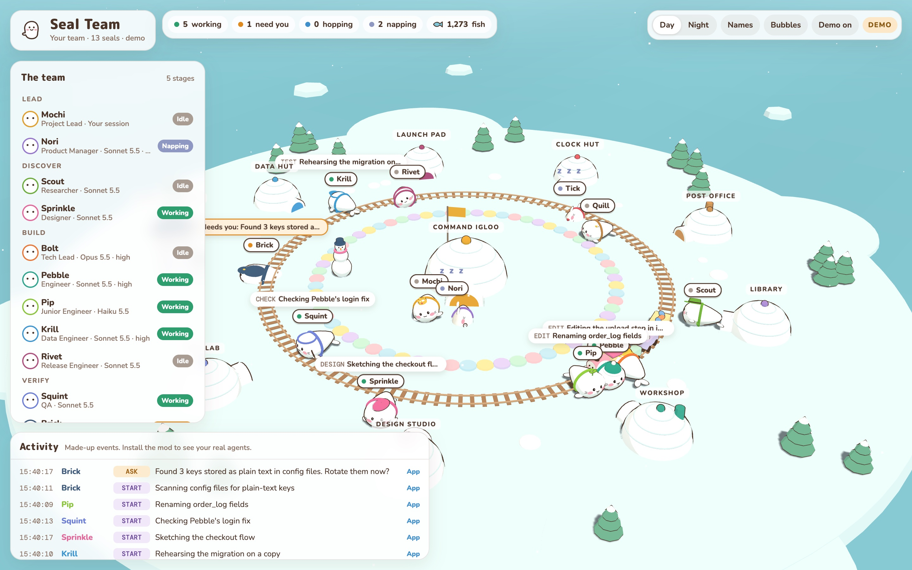

# Seal Team

**A product team of expert agents for Claude Code.** Seal Team asks the right questions before it plans, scales the process to the size of the job, builds in small reviewed steps, and stops for your approval at every decision that matters.



## Contents

- [Overview](#overview)
- [Installation](#installation)
- [Getting started](#getting-started)
- [How it works](#how-it-works)
- [The team](#the-team)
- [Commands](#commands)
- [Cost and quality](#cost-and-quality)
- [Privacy and safety](#privacy-and-safety)
- [Development](#development)
- [Licence](#licence)

## Overview

Seal Team turns your Claude Code session into a lead, **Mochi**, who works with 12 specialist subagents: product, research, design, architecture, engineering, data, release, QA, security, tracking and reporting.

| Capability | What it means for you |
|---|---|
| **Advisor-led intake** | Before planning, Mochi asks about users, scale, data, deadline, budget, privacy and architecture. Every question comes with a recommended answer, and the interview shrinks or disappears for small jobs. |
| **Process in proportion** | A one-line fix gets a fix and a review. A new product gets a PRD, a design and a plan of small tasks. |
| **Audit before change** | For an existing codebase, the Assess stage produces a ranked report with a concrete case and the smallest fix for each finding. Nothing changes until you choose. |
| **Reviewed, incremental builds** | Each task goes to a fresh agent with a self-contained brief, and a reviewer checks it before the next task starts. |
| **Proof of done** | Bug fixes and risky changes (branches, parsers, money, security, data writes) ship with a test that fails without the change. |
| **Hard stops** | Seal Team stops for your approval after an audit, after the PRD, after the plan, and before anything is deployed, published, pushed or deleted. |
| **Durable project memory** | Decisions, acceptance criteria, risks and open questions are pinned in `MEMORY.md` and added to every request. A guard refuses any edit that drops a pinned item. |
| **Right-sized models** | Mochi hands work to a seal or a cheaper model on its own, without asking you, and picks the model and effort for each task. Subagents are capped at Claude Opus 5.5 and `high` effort. |
| **Live visibility** | A status line, notifications when a seal needs you, a `/seals` panel with per-agent token use, and an optional 3D view of the team at work. |

## Installation

In an interactive Claude Code session, run:

```
/plugin install seal-team --marketplace mlemxy/seal-team
```

Confirm adding the marketplace, then choose the **user** scope to enable Seal Team in every project.

To update:

```bash
claude plugin update seal-team@seal-team
```

Restart Claude Code after installing or updating.

**Optional:** giving seals work from the 3D view requires `python3`. Without it the view still opens, to watch only.

## Getting started

Describe what you want in plain language. Mochi chooses the path:

| You bring | What happens |
|---|---|
| An idea or a large feature | Intake, then the full product stages below |
| An existing or half-built repository | A short intake, then an assessment in `ASSESSMENT.md`. **Stops for you to choose what to fix.** |
| A change to review | Bolt reviews it, bringing in Brick, Krill or Sprinkle when the change touches security, data or UI |
| A small fix | Build, review, then the ship stop |
| Research, writing or a decision to think through | Mochi talks it over with you while Scout checks the facts and Nori or Bolt draft the plan, with no stages |

You can also address a specialist directly, for example: *"Have Brick check the login form."*

## How it works

| Stage | Owner | Output |
|---|---|---|
| 0. Assess | Bolt, with specialists for larger audits | `ASSESSMENT.md` (existing repositories only). **Stop.** |
| 1. Discover | Scout | `RESEARCH.md`, skipped when the problem is already clear |
| 2. Define | Nori | `PRD.md` with numbered, testable acceptance criteria and known risks. **Stop.** |
| 3. Design | Sprinkle, Bolt | `DESIGN.md`: flows, screens, architecture |
| 4. Plan | Bolt, Tick | `PLAN.md`: small tasks with owner, model and size, plus a Gantt chart. **Stop.** |
| 5. Build | Pebble, Pip, Krill, Rivet | One fresh agent per task, each reviewed by Squint (and Bolt for risky work) |
| 6. Verify | Squint, Brick, Bolt | `TEST-REPORT.md`, security sign-off, final review |
| 7. Ship | Rivet, Quill | `RELEASE.md`. **Nothing ships until you say so.** Then release notes. |

At every stop, Quill writes a five-line stage card (stage, done, next, needs you, risks) and updates `MEMORY.md`; Tick updates `STATUS.md`. Gantt charts are Mermaid blocks and render on GitHub, in VS Code and in Obsidian.

### Project files

Project files live in `seal-team/` at the repository root. By default they are excluded from git through `.git/info/exclude`, so they are never committed by accident. On first use, Mochi asks whether you want to commit them for your team instead, and warns that they contain plans, notes and security findings that anyone can read if the repository is public.

Personal preferences that apply across projects are stored in `~/.seal-team/preferences.md`.

## The team

| Agent | Role | Default model |
|---|---|---|
| **Mochi** | Lead and advisor: chooses the path, runs the intake, assigns work, stops for approval | Your session |
| **Nori** | Product manager: intake questions, PRD, scope, risks, decisions | Sonnet 5.5 · high |
| **Scout** | Researcher: users, prior art, technical options, primary sources | Sonnet 5.5 · medium |
| **Sprinkle** | Designer: flows, UI, accessibility | Sonnet 5.5 · medium |
| **Bolt** | Tech lead: architecture, task plans, audits, hard debugging, reviews | Opus 5.5 · medium |
| **Tick** | Tracker: schedule, Gantt chart, deadlines, `STATUS.md`, calendar (asks first) | Haiku 5.5 · low |
| **Pebble** | Engineer: features, fixes, refactors and their tests | Sonnet 5.5 · high |
| **Pip** | Junior engineer: renames, formatting, lint, version bumps | Haiku 5.5 · low |
| **Krill** | Data engineer: schemas, reversible migrations, queries | Sonnet 5.5 · high |
| **Rivet** | Release engineer: CI, builds, deploys, release checklist | Sonnet 5.5 · medium |
| **Squint** | QA and reviewer: per-task review, acceptance criteria, edge cases, test health | Sonnet 5.5 · medium |
| **Brick** | Security: input handling, authentication, secrets, data leaving your machine | Sonnet 5.5 · medium |
| **Quill** | Reporter: stage cards, `MEMORY.md`, status reports, release notes, docs | Haiku 5.5 · low |

Defaults are starting points. Mochi moves an agent up or down a tier for a single task based on its difficulty, and an agent that is out of its depth escalates immediately instead of guessing.

## Commands

| Command | Description |
|---|---|
| `/seals` | Panel showing each agent's model, current task, tokens used and completed tasks |
| `/seal-island` | Opens the live 3D view for the current project in your browser. Type on a seal's card to give it work: the ask arrives in Claude Code and Mochi hands it to that seal |

## Cost and quality

Seal Team ships with an evaluation suite in [`evals/`](evals/README.md) that runs the same tasks with and without the plugin, then scores each result with a hidden check.

Measured against plain Claude Code on single-step tasks:

| Task type | Pass rate | Regression test written | Cost per task |
|---|---|---|---|
| Risky fixes (pagination bug, path traversal, data import, date filter) | Equal | **8 of 8** vs 0 of 8 | +53% |
| Tasks that need no test | Equal | n/a | +33% |

On these small tasks, the extra cost is the brief and the tests Seal Team writes. Savings from routing work to cheaper models apply to multi-step projects, which the current suite does not yet measure. Sample sizes are small; run the suite yourself to get figures for your workload.

## Privacy and safety

- **Approval required** for deploying, publishing, pushing, sending or deleting anything.
- **No network calls** from the plugin. The 3D view is served by a small server on `127.0.0.1` only, reachable from this computer alone, and three.js is bundled so it works offline.
- **Redacted commands.** Shell commands appear in the status line, panel and 3D view as the program and subcommand only (for example `git push`), never with arguments, so tokens in a command line are not displayed.
- **Asks from the 3D view** are accepted only from the page itself: a new secret in the link each session, and a same-origin JSON request, so another website open in your browser cannot send work to Claude Code.
- **Calendar access** is used only after you agree.

## Development

| Path | Contents |
|---|---|
| `agents/*.md` | The 12 specialist agents: role, procedure, default model and effort |
| `hooks/brief.ts` | Mochi's always-on brief: paths, model choice and code rules |
| `skills/playbook/` | The full intake and stage playbook, loaded only when needed |
| `hooks/register.tsx` | The plugin runtime: model cap, agent tracking, panel, status line, memory guard, 3D view feed |
| `hooks/memory.ts` | Memory guard logic for pinned items in `MEMORY.md` |
| `hooks/register.test.ts` | Tests |
| `island/` | The 3D view, its local server (`serve.py`) and bundled three.js |
| `evals/` | Evaluation tasks, hidden checks and runner |

```bash
claude plugin validate .
claude plugin test .
claude --plugin-dir .
```

The last command starts a session using your working copy. If the plugin is also installed from the marketplace, uninstall it while developing.

## Licence

MIT. See [LICENSE](LICENSE), and [THIRD_PARTY_NOTICES.md](THIRD_PARTY_NOTICES.md) for Ponytail and three.js.
